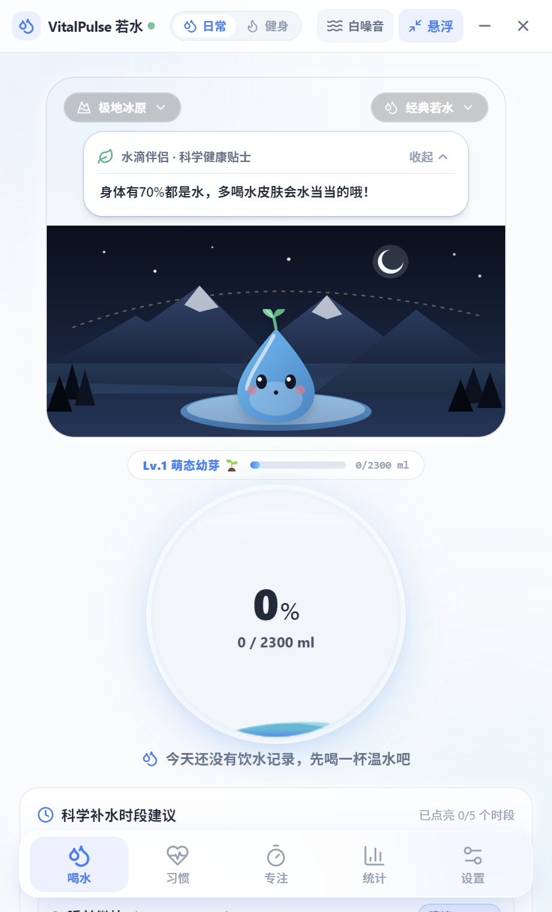
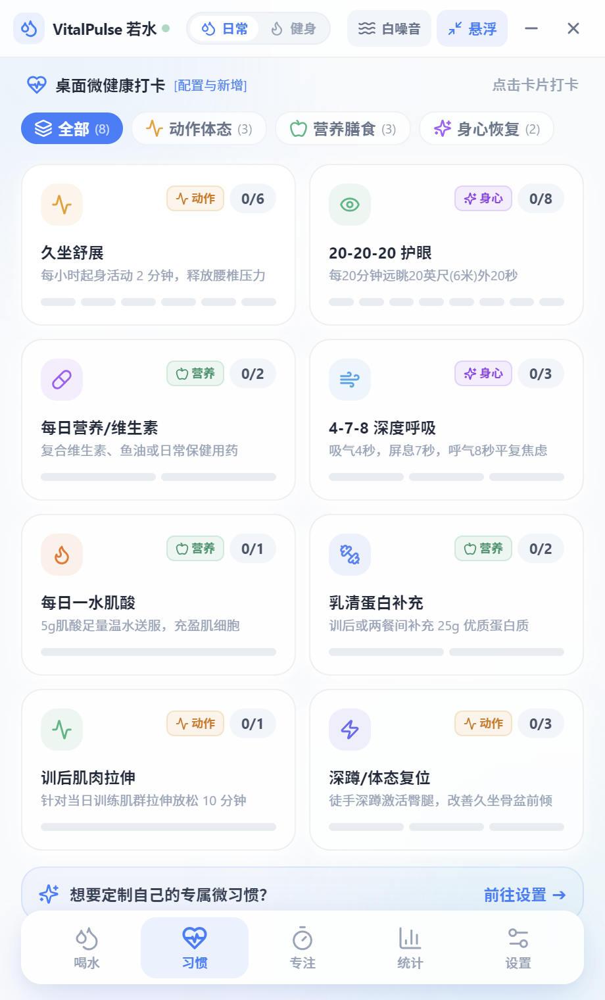
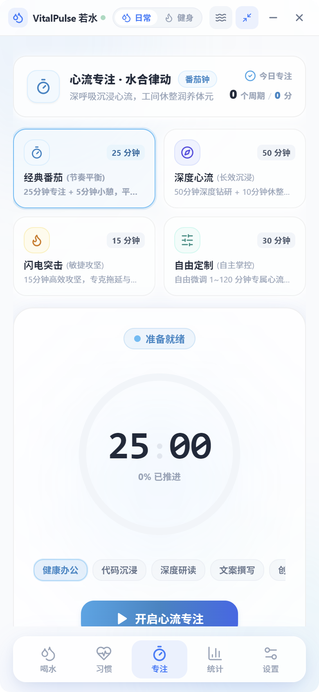
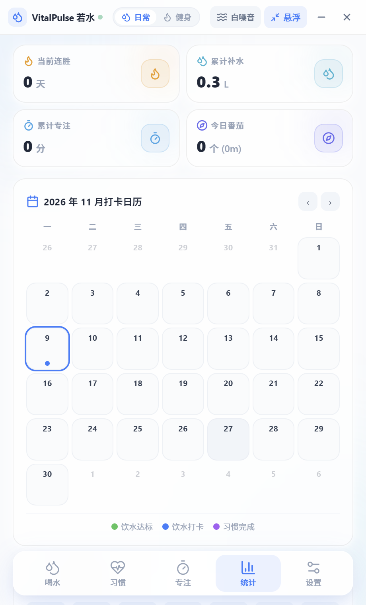
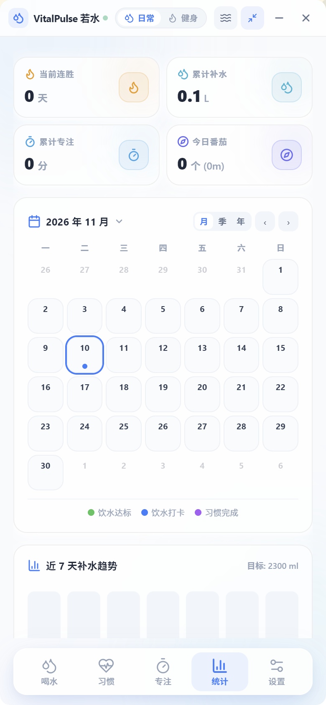
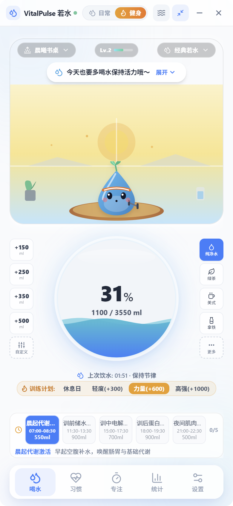

# VitalPulse 若水 · 产品介绍

> 一款把「专注、补水、呼吸、体态」串成一条闭环的 Windows 桌面健康伴侣。
> 不催命、不打扰，只在你最需要的那一刻，轻轻提醒你喝一口水、站起来、深呼吸。

---

## 一、这是一款什么样的产品

**VitalPulse 若水** 是一款面向久坐人群的 Windows 桌面端身心健康工具。它把原本分散在四五个 App 里的功能——番茄钟、喝水提醒、白噪音、习惯打卡、健康统计——收进同一个窗口，并且让它们彼此联动：

**开始专注 → 自然声景自动响起 → 专注结束 → 自动提醒补水并引导起身 → 数据沉淀为趋势。**

产品的设计语言取自 Apple 人机交互指南（HIG）与 Tide、Calm 一类静谧心流应用：通透的毛玻璃、柔和的天蓝水感渐变、会呼吸的水波。它安静地待在屏幕一角，需要时才被看见。

---

## 界面一览

<table>
  <tr>
    <td align="center" width="50%"> <b>喝水主页</b>：微景观生态箱 + 水滴伴侣「小若水」，球体两侧一键补水，底部常显时段节律</td>
    <td align="center" width="50%"> <b>微习惯矩阵</b>：动作体态 / 营养膳食 / 身心恢复三类共 8 项打卡，可自由配置</td>
  </tr>
  <tr>
    <td align="center" width="50%"> <b>心流专注</b>：四套番茄预设 + 潮汐进度环，光条开关联动声景与补水提醒</td>
    <td align="center" width="50%"> <b>趋势统计</b>：连胜勋章 + 月/季/年三视图打卡日历，板块可折叠</td>
  </tr>
  <tr>
    <td align="center" width="50%"> <b>设置中心</b>：运行模式切换、按体重与活动负荷智能测算每日目标</td>
    <td align="center" width="50%"> <b>健身模式</b>：训练强度叠加目标水量，围训练期五时段黄金补水节律</td>
  </tr>
</table>

---

## 二、为谁而做

| 人群 | 真实困境 | 若水给出的解法 |
| :--- | :--- | :--- |
| **久坐办公者** | 一忙起来半天不喝水，腰背酸胀才想起起身 | 定时补水提醒 + 起身舒展习惯打卡 |
| **程序员 / 设计师** | 深度工作被打断，噪音环境难以进入心流 | 深度心流番茄钟 + 实时合成声景掩蔽噪音 |
| **健身爱好者** | 训练日饮水量算不准，围训练期补水无序 | 按体重/训练强度自动重算目标 + 五时段节律补水 |
| **易焦虑 / 浅眠人群** | 知道要放松，但不知道怎么做 | 4-7-8 正念呼吸光环引导 + 潮汐白噪音 |
| **数据派用户** | 打卡全靠自觉，看不到长期变化 | 月度日历、生涯勋章、饮水与专注双流水 |

---

## 三、核心能力

### 1. 心流番茄钟：专注与补水在同一条时间线上

- **四套预设节奏**：经典番茄（25 + 5）、深度心流（50 + 10）、闪电突击（15 + 3），以及 10~90 分钟自由定制。
- **结束时不是一声刺耳铃声**：柔和庆贺音 + 五彩纸屑 + 工间补水卡片，提供 `+150ml / +200ml / +300ml` 一键打卡，顺手把你从椅子上"请"起来。
- **潮汐进度环**：SVG 渐变流光跟随倒计时推进，细微呼吸律动，不抢注意力。

### 2. 自然声景：不下载任何音频文件

六种声景（高山清溪、雨落窗台、林海松风、围炉暖火、潮汐海浪、深空星云）由 Web Audio API 实时合成，**零 MP3/WAV 依赖，零网络请求**：

- 打开即响，没有加载等待，不占磁盘；
- 音量无级推子，切换时平滑淡入淡出；
- 可与番茄钟自动联动：开始播放，暂停淡出，结束静音。

### 3. 水球与「小若水」：把喝水量变成看得见的上涨

- Canvas 2D 实时渲染的双谐波水波，随当日饮水量平滑上涨，60fps。
- 水滴精灵「小若水」有 **4 种形态**（经典若水 / 极地冰晶 / 治愈茶灵 / 电光星核）× **4 个微景观生态箱**（极地冰原 / 晨曦书桌 / 禅意茶庭 / 赛博星舱）可自由组合。
- 轻触它会弹一下，冒出气泡与爱心；对话气泡可展开阅读当天的科学补水贴士。

### 4. 双模式：办公日与训练日，两套算法

顶栏一键切换 **日常办公 ⇄ 硬核健身**：

- **办公模式**：按体重、作息给出基础目标，配合久坐提醒。
- **健身模式**：在基础目标上叠加训练强度（轻度 +300ml / 力量 +600ml / 高强 +1000ml）、肌酸期 +500ml、高蛋白增肌期 +300ml，并给出围训练期五时段节律：07:00 晨起激活、12:00 训前储水、16:00 训中电解质、18:30 训后吸收、21:30 夜间修护。

### 5. 饮品折算与微习惯

- 喝的不只是白水：绿茶/乌龙 0.95、美式咖啡 0.80、牛奶拿铁 0.85、电解质水 1.05、果汁汽水 0.65，按系数折算真实水合量。
- 除纯净水外，所有饮品都可增删、改系数、换颜色，也可一键恢复默认。
- 微习惯覆盖三类：动作体态（起身舒展、骨盆复位）、营养膳食（维生素/鱼油）、身心恢复（20-20-20 远眺、4-7-8 呼吸）。

### 6. 趋势与历史：让坚持有据可查

- 生涯勋章：连续打卡天数、累计饮水升数、累计专注分钟、番茄总数。
- 月度日历按周一到周日对齐，达标日一眼可见；点任意日期就能下钻查看当天的补水量、习惯与专注记录。
- 今日摄入结构饼图 + 饮水/专注双流水时间线，支持补记与误记录清除。

### 7. 桌面形态与数据归属

- **迷你胶囊**：一键收缩为 250×80px 的半透明水滴小组件，贴边显示倒计时与任务标签，不遮主屏。
- **托盘常驻**：关闭主窗口不退出，后台继续守护提醒。
- **绿色免安装数据**：数据写在程序同级 `data/vitalpulse_data.json`，不写注册表，整个文件夹拷走即迁移；支持 JSON 全量导出备份与导入恢复。

---

## 四、一天里它怎么工作

| 时间 | 场景 | 若水的角色 |
| :--- | :--- | :--- |
| 09:00 | 打开电脑，列出今日任务 | 弹出今日饮水目标；点击「深度心流 50 分钟」，雨声渐入 |
| 09:50 | 一轮专注结束 | 纸屑 + 补水卡片：`+200ml`，顺手起身舒展并打卡 |
| 14:30 | 午后困顿 | 4-7-8 呼吸光环引导三轮；潮汐声景与呼吸同频 |
| 18:30 | 训练结束 | 健身模式下自动提示训后蛋白吸收补水 700ml |
| 21:30 | 一天收尾 | 日历亮起达标标记，生涯连胜 +1 |

---

## 五、设计与技术底座

- **界面**：Vue 3.5 组合式 API + Tailwind CSS 3.4 纯实用类，Lucide 线性图标（统一 2.2px 线宽），无系统 Emoji、无行内样式。
- **类型**：TypeScript 5.7 严格模式，核心数据结构全程静态推导。
- **状态**：Pinia 模块化 Store，双通道持久化（LocalStorage + 本地 JSON 文件）。
- **音频**：Web Audio API 节点图（双二阶滤波器、粉红/布朗噪声缓冲、次低频双耳振荡）实时合成。
- **质量**：Vitest 覆盖补水算法、围训练期配比、进度换算等核心逻辑。
- **桌面**：Electron 34 + electron-builder，Windows 10/11 绿色运行。

> 关于体积：Electron 应用自带 Chromium 与 Node 运行时，解压后约 180MB；若水自身业务代码（全部组件、样式、状态与六套音频算法）仅约 360KB，压缩后整体下载约 60MB 量级。

---

## 六、下载与安装

**下载地址**：[Gitee 发行版 · harimasal/waterManager](https://gitee.com/harimasal/waterManager/releases)

**直接下载（Windows）**：[waterManager.rar · v1.0.0（约 88MB）](https://gitee.com/harimasal/waterManager/releases/download/v1.0.0/waterManager.rar)

1. 点击上方链接或到发行版页面下载 `waterManager.rar`；
2. 解压到任意目录（建议非系统盘、无中文特殊字符的路径）；
3. 双击 `VitalPulse 若水.exe` 直接运行，无需安装、无需管理员权限；
4. 首次启动会在程序同级生成 `data/` 目录用于保存健康档案。

**升级**：下载新版本解压到新目录，把旧目录的 `data/` 整个复制过去即可延续历史数据。

---

## 七、常见问题

**Q：会不会很占内存？**
Electron 应用的常驻内存在 100~200MB 区间，属于该类框架的正常水平；静置时 CPU 占用接近 0。

**Q：关掉窗口就没提醒了吗？**
不会。关闭主窗口会最小化到系统托盘，定时提醒与番茄计时继续运行。

**Q：数据会上传吗？**
不会。全部数据只落本地 JSON 文件，无账号、无服务端、无网络请求（声景为实时合成，也不需要联网）。

**Q：目标水量怎么算的？**
基础值由体重与日常活动推导，再叠加饮品折算、训练强度、补剂周期等修正项；算法逻辑在开源仓库 `src/utils/calculator.ts` 中可查。

---

## 八、开源与免责声明

- 开源协议：[MIT](LICENSE)，源码托管于 [Gitee](https://gitee.com/harimasal/waterManager)。
- 本产品提供的饮水建议、时段节律与习惯引导基于普遍科学与人体工程学常识，**不构成专业临床医疗诊断依据**。慢性肾病、心功能不全等特殊人群请遵医嘱调整补水目标。
